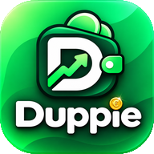
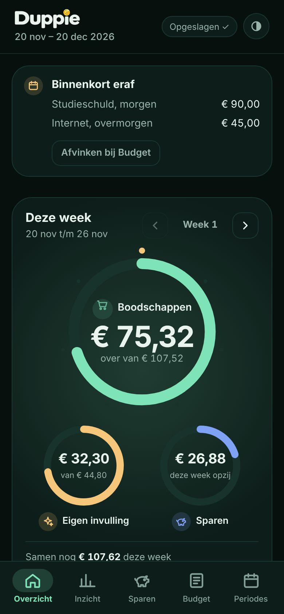
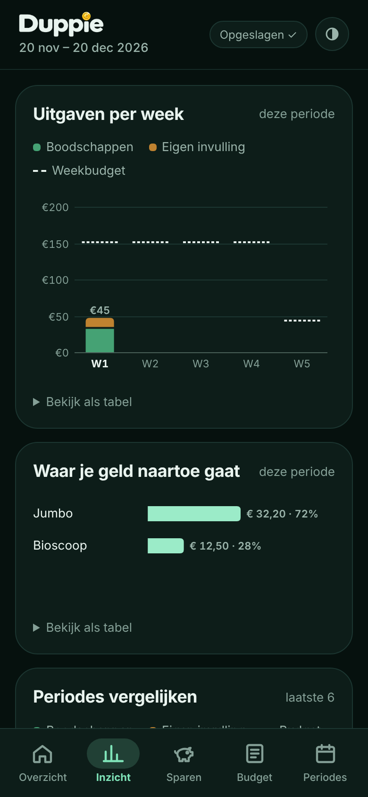
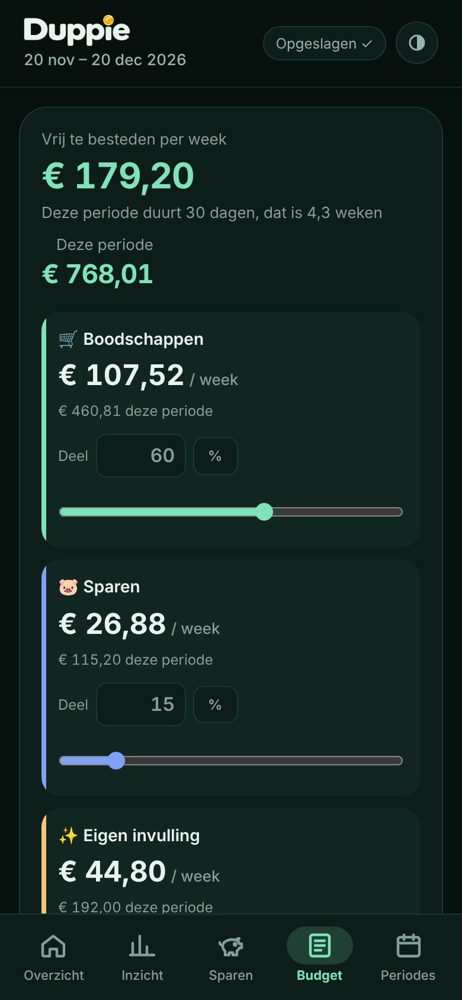
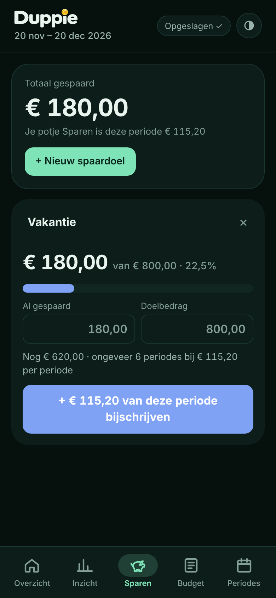

**Duppie** is een gratis, eenvoudige budget-app voor je telefoon, gebaseerd op de **potjesmethode**.
Je ziet in één oogopslag wat je deze week nog kunt uitgeven.

**👉 Gebruik de app:** [benthemannl.github.io/BudgetApp](https://benthemannl.github.io/BudgetApp/)
*(open de link op je telefoon en zet hem op je beginscherm, zie hieronder)*

  
  
  
  

## Wat kan de app?

- **Weekbudget:** je vrije geld wordt verdeeld over de weken van je periode. Een ring laat zien hoeveel je deze week nog over hebt, en hoeveel je nog **per dag** kunt uitgeven.
- **Tempo-waarschuwing:** geef je sneller uit dan je budget toelaat, dan waarschuwt de app op tijd.
- **Meenemen:** wat je in een week overhoudt (of te veel uitgeeft) telt mee in de volgende week. Aan het einde van de periode gaat de rest naar de volgende periode of naar je spaardoel.
- **Potjes:** verdeel je vrije budget over 🛒 Boodschappen, 🐷 Sparen en ✨ Eigen invulling met schuifjes. Eigen invulling vangt de verschillen op.
- **Uitgaven bijhouden:** voer snel in wat je uitgeeft, of **importeer je bankafschrift** (CSV van ING, Rabobank, ABN AMRO, ASN/SNS/RegioBank en bunq, of PDF van ING).
- **Bonnetjes scannen:** maak een foto van je kassabon. De app leest de winkel, de datum, het totaal en wat je gekocht hebt, en zet het als uitgave neer. Je controleert alles eerst. Het lezen gebeurt op je eigen telefoon: de foto gaat niet het internet op.
- **Inzicht:** grafieken van je uitgaven per week, per winkel en per periode.
- **Vaste lasten en inkomsten:** met automatische icoontjes (🏠 huur, ⚡ energie, 💧 water…) en afschrijfdatums, zodat je ziet wat er nog van je rekening af gaat.
- **Tijdelijke inkomsten:** extra geld telt mee vanaf de dag dat je het krijgt.
- **Aflossingen:** vul je restschuld in en zie wanneer je schuldvrij bent. Elke periode gaat de restschuld automatisch omlaag.
- **Spaardoelen:** met voortgangsbalk en hoeveel periodes je nog nodig hebt.
- **Periodes:** je kiest zelf wanneer een periode begint (bijvoorbeeld van de 20e tot de 20e). Als een periode voorbij is, start de app vanzelf een nieuwe. Oude periodes blijven bewaard.
- **Werkt offline**, met lichte, donkere of automatische weergave.

## Privacy

Al je gegevens blijven **alleen op je eigen telefoon**. Er gaat niets naar een server, er is geen account nodig en er wordt niets gevolgd.
Daarom zit er een knop in om een **back-up** te maken (tabblad *Periodes*). Bewaar die bijvoorbeeld in iCloud Drive of Google Drive.

## Installeren op je telefoon

**iPhone**
1. Open de link in **Safari**.
2. Tik op Delen (vierkantje met pijl) → **Zet op beginscherm** → **Voeg toe**.
3. Open de app voortaan via het icoon op je beginscherm.

**Android**
1. Open de link in **Chrome**.
2. Tik op de drie puntjes → **App installeren** of **Toevoegen aan startscherm**.

> Let op: op de iPhone heeft de app op je beginscherm een eigen opslag, los van Safari.
> Zet een back-up dus terug vanuit de app op je beginscherm.

## Licentie

© 2026 BenTheManNL. Alle rechten voorbehouden.

Je mag de app gratis gebruiken voor persoonlijk gebruik via de link hierboven.
Het is **niet** toegestaan de app aan te passen, te kopiëren, opnieuw te publiceren of commercieel te gebruiken.
Zie [LICENSE](LICENSE) voor de volledige voorwaarden.

De app gebruikt [PDF.js](https://mozilla.github.io/pdf.js/) van Mozilla (Apache-2.0) om PDF-afschriften te lezen, zie `lib/pdfjs`.
Voor het lezen van bonnetjes gebruikt de app [tesseract.js-core](https://github.com/naptha/tesseract.js-core) en de Nederlandse taaldata uit [tessdata_fast](https://github.com/tesseract-ocr/tessdata_fast) (beide Apache-2.0), zie `lib/ocr`.
